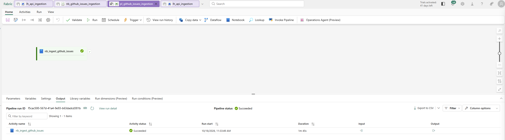
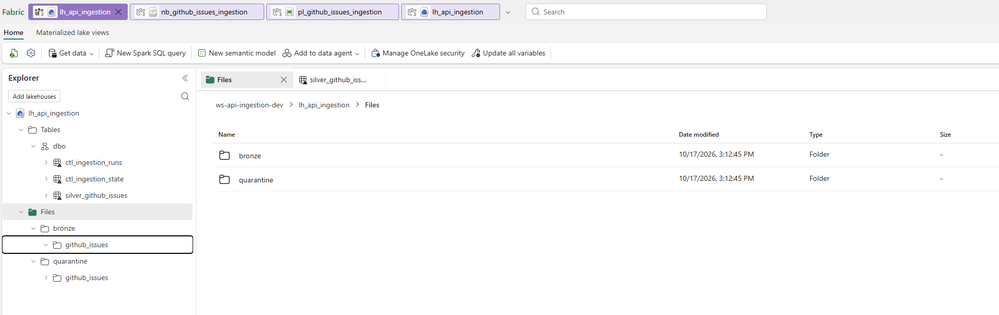
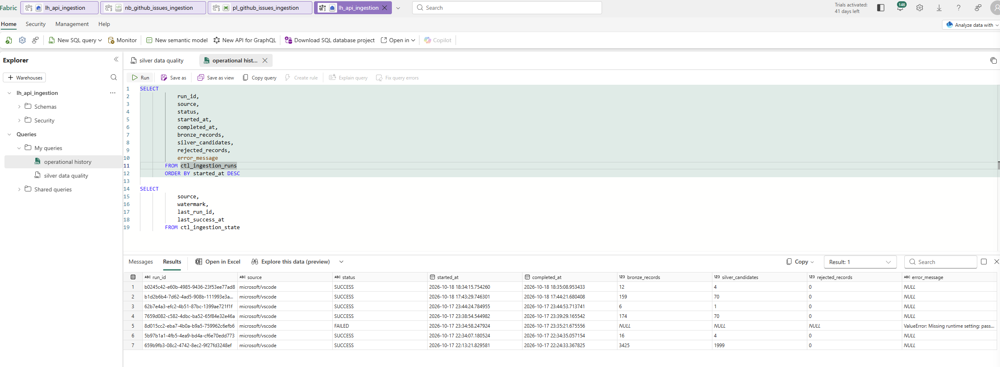
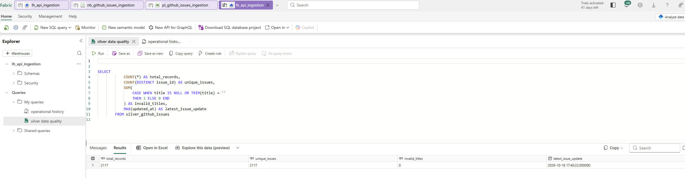

# Python REST API Ingestion Framework with Microsoft Fabric

A reusable Python REST API ingestion framework demonstrating incremental data extraction, fault-tolerant HTTP integration, Bronze/Silver processing, data validation, operational logging, failure recovery, and Microsoft Fabric Lakehouse integration.

## Overview

This project demonstrates how to design and implement a maintainable API ingestion solution using Python, GitHub REST API, Apache Parquet, Microsoft Fabric, PySpark, and Delta Lake.

The solution supports two execution environments:

- **Local Python:** VS Code-based development with raw JSON, validated Parquet datasets, SQLite operational tracking, and automated tests.
- **Microsoft Fabric:** Notebook-based ingestion into OneLake with standardized Silver Delta tables, incremental upserts, and Data Pipeline orchestration.

The objective is to demonstrate practical enterprise data engineering patterns in a small, independently maintainable project.

## Business Use Case

Engineering organizations need reliable access to repository issue data for operational reporting and trend analysis.

The framework ingests GitHub issues from a configurable public repository and prepares standardized records containing issue identifiers, titles, states, authors, labels, and lifecycle timestamps.

The resulting Silver data can support questions such as:

- How many issues are currently open or closed?
- Which issues were updated most recently?
- How does issue activity change over time?
- Which labels occur most frequently?

The default source is the public `microsoft/vscode` repository.

## Architecture

```text
GitHub REST API
       |
       v
Python HTTP Client
Authentication | Pagination | Retries | Incremental Filters
       |
       v
Bronze — Raw JSON
       |
       v
Validation and Normalization
       |
       +----> Quarantine (invalid records)
       |
       v
Silver — Current Issue Dataset
       |
       +---- Local: Parquet snapshot
       |
       +---- Fabric: Delta Lake MERGE

Operational Controls:
- Extraction watermark
- Run history and stage status
- Processing metrics
- Failure recovery
```

The API client, pagination logic, transformation functions, and validation rules are shared across local and Fabric implementations.

Storage, state management, and orchestration are implemented separately for each runtime.

See [Architecture Details](docs/architecture.md).

## Technology Stack

| Area | Technologies |
|---|---|
| API integration | Python, requests, GitHub REST API |
| Configuration | YAML, environment variables |
| Transformation | Python, PyArrow, PySpark |
| Storage | JSON, Parquet, OneLake, Delta Lake |
| Data quality | Required-field validation, schema enforcement, quarantine |
| State management | JSON checkpoints, SQLite, Delta control tables |
| Orchestration | Python CLI, Microsoft Fabric Data Pipeline |
| Secrets | Environment variables, Azure Key Vault |
| Testing | pytest, mocked HTTP responses |
| Source control | Git, GitHub |

## Implemented Capabilities

### API ingestion

- Token-based REST API authentication
- Configurable source repository and request parameters
- Link-header pagination
- Timestamp-based incremental extraction
- HTTP timeout and connection error handling
- Exponential backoff and bounded retries
- HTTP 429 and rate-limit-aware handling

### Data engineering

- Raw JSON Bronze landing
- Nested JSON normalization
- Explicit field and timestamp validation
- Pull request filtering
- Rejected-record quarantine
- Stable-key deduplication
- Current-state Silver Parquet snapshots
- Delta Lake incremental upserts in Microsoft Fabric, with a documented same-timestamp policy

### Operational reliability

- Unique execution identifiers
- Structured execution logging
- Durable local run and stage history in SQLite
- Extraction and Silver processing checkpoints
- Safe Silver replay after interrupted processing
- Simulated failure and recovery tests
- Fabric checkpoint advancement only after verified Silver commits
- Fabric run history with final status and failing stage for every execution
- Fabric recover mode for reprocessing Bronze files from unsuccessful runs
- Fabric pipeline execution monitoring, with the run result returned as the notebook exit value

## Repository Structure

```text
src/api_ingestion/    Reusable Python ingestion and processing modules
config/               Source and execution configuration
tests/                Automated unit and recovery tests
notebooks/            Microsoft Fabric notebook implementation
pipelines/            Microsoft Fabric Data Pipeline definition
docs/                 Architecture, deployment, operations, and design decisions
data/                 Local generated datasets (excluded from Git)
logs/                 Local execution logs (excluded from Git)
```

## Local Development

### Prerequisites

- Python 3.11 or 3.12
- Git
- A GitHub personal access token
- VS Code or another Python development environment

### Installation

Clone the repository and open a terminal in its root directory.

```powershell
python -m venv .venv
.\.venv\Scripts\Activate.ps1
python -m pip install -e ".[dev]"
```

Copy `.env.example` to `.env` and provide your GitHub token.

Never commit `.env` or actual credentials.

### Run API extraction

```powershell
python -m api_ingestion --config config/settings.yaml
```

Raw responses are written to `data/bronze/`.

### Build Silver locally

```powershell
python -m api_ingestion.silver --config config/settings.yaml
```

The standardized dataset is written to:

`data/silver/github_issues.parquet`

Rejected records are written to:

`data/quarantine/github_issues_rejected.jsonl`

### Execute the complete pipeline

```powershell
python -m api_ingestion.pipeline --mode full
```

To reprocess Silver from existing Bronze files without another API request:

```powershell
python -m api_ingestion.pipeline --mode silver-only
```

To exercise recovery, inject a failure after either stage. The Silver checkpoint is not advanced, and `--mode silver-only` then rebuilds Silver from the Bronze files already landed:

```powershell
python -m api_ingestion.pipeline --mode full --inject-failure after-bronze
python -m api_ingestion.pipeline --mode full --inject-failure after-silver
```

Run and stage history is recorded in `data/state/operations.db`.

## Microsoft Fabric Implementation

The Fabric implementation uses:

| Component | Name |
|---|---|
| Data Pipeline | `pl_github_issues_ingestion` ([definition](pipelines/pl_github_issues_ingestion.json)) |
| PySpark Notebook | `nb_github_issues_ingestion` ([source](notebooks/nb_github_issues_ingestion.ipynb)) |
| Lakehouse | `lh_api_ingestion` (Bronze and quarantine files in OneLake) |
| Silver Delta table | `silver_github_issues` |
| Control tables | `ctl_ingestion_state` (watermark), `ctl_ingestion_runs` (run history) |
| Credentials | Azure Key Vault, read at runtime with `notebookutils.credentials.getSecret` |
| Shared modules | `src/api_ingestion`, uploaded as notebook built-in resources |

The notebook reuses the shared client, transformation, and validation modules. Spark and Delta Lake handle storage and upserts. All work runs in one `run_ingestion()` function, which:

- records every execution in `ctl_ingestion_runs` with its final status and, on failure, the failing stage;
- MERGEs into Silver, then verifies that every candidate was committed;
- advances the watermark only after verification passes and no records were quarantined.

The pipeline passes `mode` (`incremental` or `recover`) and `recover_run_id` as pipeline parameters. It runs with concurrency 1 and returns the run result as the notebook exit value. Secrets and environment-specific values are never stored in the notebook source.

See [Architecture](docs/architecture.md), [Fabric Setup Guide](docs/fabric-setup.md), and [Fabric Operations Runbook](docs/fabric-operations.md).

**Note:** A working Fabric workspace, configured identity, Lakehouse, and Key Vault are required to reproduce the cloud implementation. Credentials and cloud resources are not bundled with this repository.

## Testing

Run the complete test suite:

```powershell
python -m pytest tests/ -v
```

Tests cover:

- Successful and unsuccessful HTTP requests
- Authentication failures
- Retry and rate-limit behavior
- Pagination formats and page limits
- Request timeouts
- Timestamp and schema validation
- Deduplication and Silver transformations
- Quarantine processing
- Incremental watermark behavior
- Reruns and simulated failures
- Operational recovery
- Fabric upsert policy, including same-timestamp updates
- Fabric notebook control flow: failure logging, checkpoint gating, cancellation, and recover mode
- Fabric pipeline wiring and notebook hygiene (no outputs, secrets, or Key Vault URLs committed)

The tests use mocked API responses where practical and do not require access to the production Fabric workspace. Notebook tests run the notebook's code cells against stubbed Spark and Fabric objects.

## Operational Recovery

The framework separates successful API extraction from successful Silver publication.

If Silver processing fails after Bronze succeeds, local execution can rebuild Silver using the existing raw data without recontacting the API.

In Fabric, the checkpoint advances only after Silver is verified, so a failed run is recovered by replaying the extraction window. The Delta MERGE is replay-safe: it never duplicates issue IDs or replaces a newer version with an older one. A Bronze file from a failed run can also be reprocessed without calling the API, by running the pipeline with `mode = recover`.

See the [Operations Runbook](docs/fabric-operations.md).

## Implementation Evidence

Screenshots from the development Fabric workspace. They contain no credentials or secret configuration.

### Data Pipeline execution

`pl_github_issues_ingestion` completed with the `nb_ingest_github_issues` notebook activity in 1 minute 45 seconds.



### Lakehouse structure

`lh_api_ingestion` holds the Silver and control tables, plus the Bronze and quarantine file folders.



### Operational run history

`ctl_ingestion_runs` records every execution, including the failure. A run without its Key Vault settings was logged as `FAILED` with `Missing runtime setting`. Later runs succeeded with zero rejected records.



### Silver data quality

`silver_github_issues` has one row per issue (2,117 records and 2,117 unique issue IDs) and no blank titles.



## Design Decisions and Limitations

This is a functional portfolio reference implementation, not a fully managed enterprise production platform.

Important design considerations include:

- The local Silver implementation rebuilds a complete Parquet snapshot rather than performing Delta transactions.
- The local runner and the Fabric pipeline both assume one execution per source at a time. Fabric enforces this with pipeline concurrency 1.
- Bronze data, Silver, audit records, and checkpoints do not share one global transaction.
- Idempotent reprocessing is used to recover from partial failures.
- Rejected records block checkpoint advancement in Fabric until they are resolved. They are never silently skipped.
- The default implementation targets a single GitHub repository.
- Source data that arrives later than the 5-minute watermark overlap requires moving the checkpoint back and replaying (see the runbook).
- The Fabric implementation requires separately provisioned cloud resources.
- Secrets and generated datasets are intentionally excluded from source control.

For additional architectural rationale, see [Design Decisions](docs/design-decisions.md).

## Future Enhancements

Potential enhancements include:

- CI validation with GitHub Actions
- Incremental Silver optimization for larger volumes
- Metadata-driven support for multiple APIs
- Source reconciliation and configurable quality thresholds
- Automated environment provisioning
- Multi-environment Fabric deployment and Git integration

These enhancements are intentionally outside the initial project scope.
