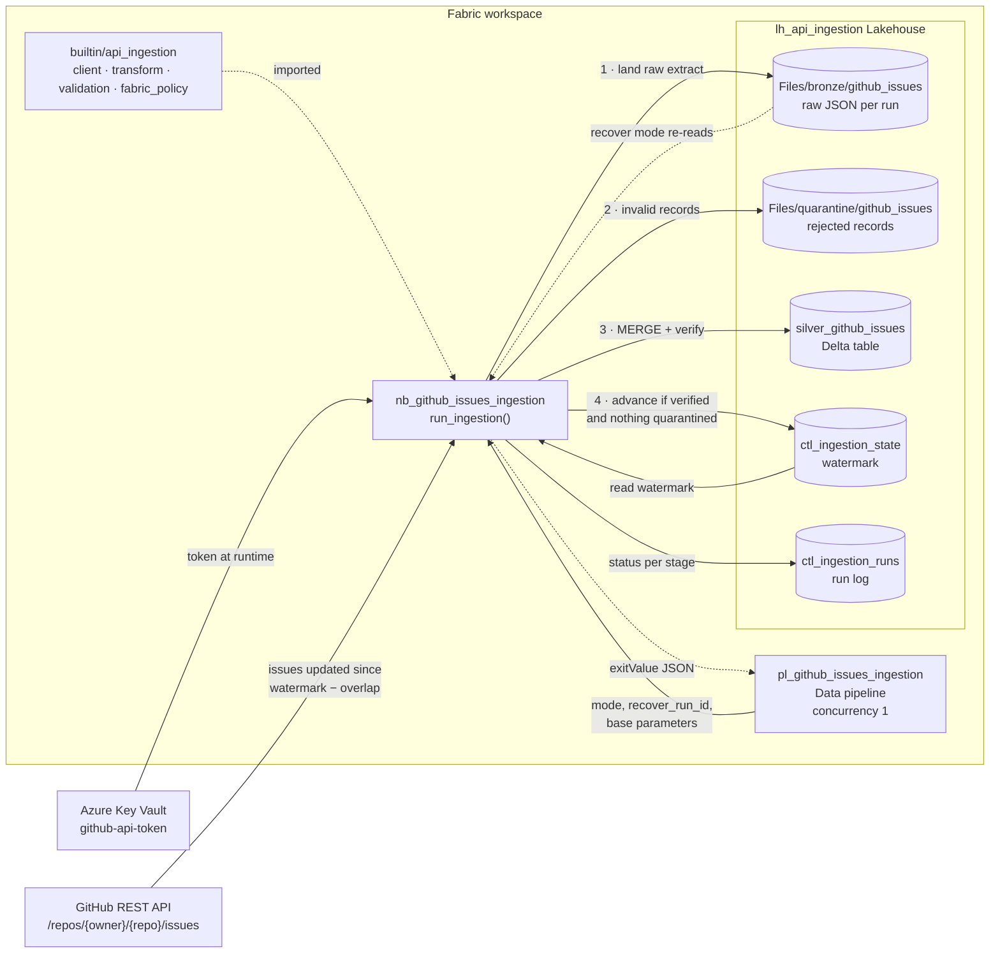

# Architecture

GitHub issues are ingested into a Microsoft Fabric Lakehouse through a
Bronze → Silver flow. A Fabric data pipeline triggers one notebook, and
the notebook does all the work in `run_ingestion()`.

## Flow

1. **Trigger.** The pipeline runs the notebook with `mode`
   (`incremental` or `recover`) and the activity's base parameters.
   Concurrency 1 prevents overlapping runs.
2. **Extract.** The notebook reads the GitHub token from Key Vault and the
   watermark from `ctl_ingestion_state`. It then pages through issues
   updated since the watermark, minus a 5-minute overlap.
3. **Bronze.** The complete extract is written as one immutable JSON file
   per run. In `recover` mode the notebook re-reads an existing Bronze
   file instead of calling the API.
4. **Transform.** Pull requests are skipped, and issues are validated and
   flattened. Invalid records go to quarantine.
5. **Silver.** Candidates are deduplicated and MERGEd into
   `silver_github_issues` under the same-timestamp policy in
   `fabric_policy.py`. Verification then confirms every candidate
   landed.
6. **Checkpoint.** The watermark moves forward only after verification
   passes and nothing was quarantined.
7. **Run log.** Every stage outcome, including failures, is recorded in
   `ctl_ingestion_runs`. The result is returned to the pipeline as the
   notebook exit value.

See [fabric-operations.md](fabric-operations.md) for procedures and
[fabric-setup.md](fabric-setup.md) for configuration.
